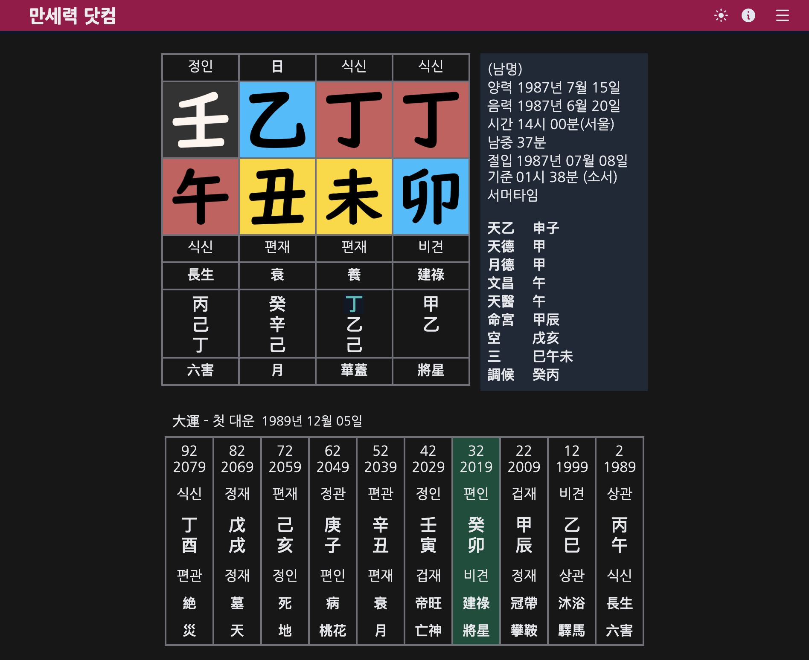

# 八字公开排盘人工抽查（2026-10-19）

## 结论与范围

从 `packages/bazi/test/fixtures/charts.json` 选取下表 **10 个不同样例**，在 Orca 浏览器实际填写公开表单、提交排盘并读取结果；共使用 4 个免费站点，每例至少有 2 个站点结果。只使用仓库中的合成样例，未注册、登录、保存到账号或填写真实个人资料。

**不是“十例全部一致”：**按本项目显示到年月的起运精度，6 例的四柱、起运年月、首运干支及年份、日空与两站均一致；另外 4 例存在起运算法、时间修正或无时辰表达差异。10 例的年/月/日三柱、日空、首步大运干支均得到两站相同结果。9 个已知时辰样例中，8 例四柱与两站一致；韩国夏令时例在默认太阳时修正的站点出现时柱差异。没有足够证据要求修改引擎，剩余同口径验证限制见下文。

引擎基准：提交 `949c7de8b13f61beb8bc441a31671f3b527f0881`，`ENGINE_VERSION = 1.0.0`，`referenceYear = 2026`。本次用 `computeChart` 与测试中的 `engineRecord` 重新计算下列 10 例，逐字段确认与 fixture 的 `expected` 相等；没有重新生成 fixture 或修改引擎。无时辰的 `fortune.approximate = true`，其起运值是中午估算。

## 来源与复核方法

| 标记 | 公开页面 | 本次使用方式与限制 |
|---|---|---|
| A | [元亨利贞四柱八字排盘](https://paipan.china95.com/BaZi.htm) | 8 例；真太阳时“不使用”，台湾→台北，按原始历法、日期、时分和性别输入。结果页是 POST 到 `/BaZi/BaZi.asp`，链接本身不保存出生参数；按下表重填即可复核。没有韩国地点、无时辰或夏令时开关，不将缺失能力当作验证通过。 |
| B | [FateTell 免费八字排盘](https://fatetell.com/zh-CN/bazi-calculator) | 全部 10 例；选择 Asia/Taipei 或 Asia/Seoul，不定位经纬度、不启用真太阳时，专业版读取四柱表、日柱列空亡与首步大运。日期只支持公历，因此闰月例输入 A 实际转换得到的 2020-06-06；不能把 B 算作第二个独立农历转换验证。无时辰勾选“出生时辰不详”，页面仍展示假定 12:00 的时柱，并明确提示。 |
| C | [问真岛八字排盘](https://www.agentfengshui.com/bazi/) | 补充无时辰例：1990-05-15、男、未知时辰/分钟、台北。地点必填且强制真太阳时；显示假定午时及相应提示，不能验证“时柱必须为空”。 |
| D | [만세력 닷컴](https://manseryeok.com/) | 补充韩国夏令时例：양력、평달、1987-07-15 14:00、서울 부근、남，额外选项保留默认 야자시 与 서머타임 적용。结果标注夏令时、남중 37분；四柱大字以图形显示，人工从[截图](2026-10-19-kr-dst.png)读取（从右到左为年/月/日/时）。 |

B 的[计算规则](https://fatetell.com/zh-CN/bazi-calculator#method)明确采用“出生到对应节的间隔占节气月的比例，以十年折算”的起运方式，本引擎采用固定“三天一岁”；两者并非同一算法。站点可访问及显示内容仅代表本次检查时的状态。

## 十个样例逐项比较

结果单元格统一为 **年柱 月柱 日柱 时柱；起运；首运（起年）；日空**。`—` 表示本引擎不输出时柱；网站的假定午时明确注明。起运按出生后的周岁时长比较，不把大运列表的虚岁序号当作起运年龄。网站 A 栏在韩国和无时辰行分别注明改用 D、C，网站 B 栏始终为 FateTell。

| 样例 id / 覆盖 | 原始输入 | 本引擎结果 | 网站 A / 补充来源结果 | 网站 B 结果 | 是否一致 |
|---|---|---|---|---|---|
| `sample-1990-taipei-male` / 普通基准 | 公历 1990-05-15 10:30，男，台北 | 庚午 辛巳 庚辰 辛巳；7年3月；壬午（1997）；申酉 | A：庚午 辛巳 庚辰 辛巳；7年3月11天；壬午（1997）；申酉 | 庚午 辛巳 庚辰 辛巳；7年0月2天；壬午（1997）；申酉 | 四柱/首运/日空一致；B 起运年月不同 |
| `term-1985-before` / 立春前 | 公历 1985-02-04 05:10，男，台北 | 甲子 丁丑 甲戌 丁卯；0年0月；戊寅（1985）；申酉 | A：甲子 丁丑 甲戌 丁卯；0年0月0天；戊寅（1985）；申酉 | 甲子 丁丑 甲戌 丁卯；0年0月0天；戊寅（1985）；申酉 | 四项一致（起运到年月） |
| `term-1985-after` / 立春后 | 公历 1985-02-04 05:13，男，台北 | 乙丑 戊寅 甲戌 丁卯；0年0月；丁丑（1985）；申酉 | A：乙丑 戊寅 甲戌 丁卯；0年0月0天；丁丑（1985）；申酉 | 乙丑 戊寅 甲戌 丁卯；0年0月0天；丁丑（1985）；申酉 | 四项一致（起运到年月） |
| `term-2000-before` / 立春前 | 公历 2000-02-04 20:39，女，台北 | 己卯 丁丑 壬辰 庚戌；0年0月；戊寅（2000）；午未 | A：己卯 丁丑 壬辰 庚戌；0年0月0天；戊寅（2000）；午未 | 己卯 丁丑 壬辰 庚戌；0年0月0天；戊寅（2000）；午未 | 四项一致（起运到年月） |
| `term-2000-after` / 立春后 | 公历 2000-02-04 20:42，女，台北 | 庚辰 戊寅 壬辰 庚戌；0年0月；丁丑（2000）；午未 | A：庚辰 戊寅 壬辰 庚戌；0年0月0天；丁丑（2000）；午未 | 庚辰 戊寅 壬辰 庚戌；0年0月0天；丁丑（2000）；午未 | 四项一致（起运到年月） |
| `zi-2001-2300` / 23点换日 | 公历 2001-03-10 23:00，男，台北 | 辛巳 辛卯 癸酉 壬子；1年8月；庚寅（2002）；戌亥 | A：辛巳 辛卯 癸酉 壬子；1年8月12天；庚寅（2002）；戌亥 | 辛巳 辛卯 癸酉 壬子；1年8月8天；庚寅（2002）；戌亥 | 四项一致（起运到年月）；日精度不同 |
| `lunar-2020-leap4` / 闰四月 | 农历 2020 闰4月15日 08:00，女，台北；B 用公历 2020-06-06 | 庚子 壬午 庚辰 庚辰；0年3月；辛巳（2020）；申酉 | A：庚子 壬午 庚辰 庚辰；0年3月5天；辛巳（2020）；申酉；页面农历明确为闰四月十五 | 庚子 壬午 庚辰 庚辰；0年3月0天；辛巳（2020）；申酉；显示闰四月十五 | 排盘四项一致（起运到年月）；B 使用等价公历 |
| `tw-dst-1975` / 台湾夏令时 | 公历 1975-07-01 10:30，男，台北；本引擎使用标准时09:30 | 乙卯 壬午 戊申 丁巳；8年2月；辛巳（1983）；寅卯 | A 原始10:30：乙卯 壬午 戊申 丁巳；8年3月3天；辛巳（1983）；寅卯 | 乙卯 壬午 戊申 丁巳；7年10月14天；辛巳（1983）；寅卯 | 四柱/首运/日空一致；起运不同；A 未校正夏令时 |
| `kr-dst-1987` / 韩国夏令时 | 公历 1987-07-15 14:00，男，首尔；本引擎使用标准时13:00 | 丁卯 丁未 乙丑 癸未；2年6月；丙午（1990）；戌亥 | D：丁卯 丁未 乙丑 壬午；列表起龄2岁，首运日期1989-12-05（距生日2年4月20天，按日期推算）；丙午（1989）；戌亥 | 丁卯 丁未 乙丑 癸未；2年4月21天；丙午（1989）；戌亥 | B 四柱一致；D 时柱不同；两站起运及首运起年与引擎不同；首运干支/日空一致 |
| `nohour-1990` / 无时辰 | 公历 1990-05-15，男，台北，time=null | 庚午 辛巳 庚辰 —；估算7年3月；壬午（1997）；申酉 | C：庚午 辛巳 庚辰，假定时柱壬午；7年3月3天1时；壬午（1997）；申酉 | 庚午 辛巳 庚辰，假定时柱壬午；6年11月25天；壬午（1997）；申酉 | 三柱/首运/日空一致；B 起运不同；两站均非本项目三柱降级表达 |

## 差异诊断与引擎建议

### 1. 起运算法差异：不据此改引擎

事实：B 的普通样例为7年0月2天，而 A 为7年3月11天；B 自述按节气月比例折算，本引擎 [README §6](../../../../packages/bazi/README.md#6-大运与流年)明确使用固定三天一岁。B 在23点例、闰月例中即使年月相同，日数也不同，不能笼统归因于秒数取整；起运日数不在本轮“一致”判定精度内。

建议：保留本引擎现有算法和版本；页面继续标示起运规则。不能为了对齐 B 修改 fixture。D 未在本次结果页提供精确算法，韩国起运差异的具体计算方法仍未验证；不可断言 D 与 B 内部实现完全相同。

### 2. 台湾夏令时：控制实验支持输入口径解释

事实：A 将原始10:30标为北京时间，没有夏令时校正提示。另做一轮**派生对照**，在 A 显式输入1975-07-01 **09:30**（其余信息相同），结果仍为乙卯 壬午 戊申 丁巳、辛巳（1983）、日空寅卯，起运改为 **8年2月29天**，到年月与引擎一致。该派生输入不算新的fixture，也不替代上表原始10:30结果。

建议：不改引擎扣除夏令时的规则。这个样例09:30与10:30都在巳时，四柱相同本身不能证明网站正确处理了夏令时；本次没有验证两站在台湾夏令时的跨时辰边界行为。

### 3. 韩国时柱：太阳时修正可以解释，起运仍保留限制

事实：D 结果同时显示14:00首尔、夏令时、南中37分，时柱为壬午，首运为丙午/1989-12-05；见下图。B 用Asia/Seoul、关闭真太阳时输出癸未，与本引擎一致。

推断：14:00扣除夏令时一小时，再扣约37分钟得到12:23，落午时，能解释 D 的壬午。额外用**本引擎派生输入** `trueSolarTime: true` 复算，所用时间12:22、时柱壬午，支持修正方式差异的解释；一分钟差不能据此判断哪一方的太阳时更精确。派生复算不替代固定fixture，也不能独立验证 D 的内部算法。

建议：保留默认关闭真太阳时的行为，并展示排盘所用时间。D 起运日期与本引擎不同，尚无同算法、同时间修正开关下的独立验证；本轮不将其签为完全一致，也不以 D 的1989年直接替换引擎的1990年。

### 4. 无时辰：三柱可比，精确起运和时柱不可验收

事实：C 提示时辰未知，按12:00排盘；真太阳时显示12:09:45。B 提示时辰不详并使用假定时辰。两站都展示壬午，但这不是获得了真实出生时柱。本引擎则返回 `pillars.hour = null`、`fortune.approximate = true`，与本项目三柱降级契约一致。

建议：不添加假定时柱来追求网站外观一致；页面必须保留“需要出生时辰”和估算提示。此例仅验证三柱、日空、首运干支及起年；精确起运年龄无法从无时辰输入得到独立确认。

### 5. 节气、子时和闰月

A 显示1985立春交接05:12、2000立春交接20:40；前后样例的年/月柱与顺逆首运都按界点切换，B 同样切换。23:00样例两站均采用次日日柱癸酉、壬子时，未发现子时换日差异。A 的闰四月输入转换为2020-06-06，B 在等价公历输入下也显示闰四月十五；这验证对应关系，但 B 没有接受农历表单输入。

## 本地验证与安全范围

| 检查 | 实际结果 |
|---|---|
| `pnpm check` | 退出0；Biome有4项既有警告，无错误；其余边界与脚本测试通过 |
| `pnpm --filter @xuanxue/bazi test` | 退出0；5个测试文件、102项通过，包含51个fixture现算回归 |
| `pnpm check:deps` | 退出0；依赖检查及9项检查器测试通过 |
| `pnpm check:singletons` | 退出0；关键依赖各一个实例 |
| `git diff --check` | 退出0 |
| `security-scan` 的凭据/路径规则，范围限定本次3个变更文件 | 退出0；`files=3 candidates=0 read_errors=0`；PNG另经人工查看，仅含合成样例页面 |

安全审查以以上基准HEAD与工作区差异为界：两个Markdown和一个截图，不涉及身份/租户、服务端输入、Webhook、SSRF或积分执行入口。完整查看报告、设计diff和截图，未引入个人真实信息或凭据。先执行技能原始全仓背景扫描得到 `files=1523 candidates=126 read_errors=0`（退出1），126个候选全部位于未修改文件，统一标记为**范围外待核验**，没有将其算作全仓扫描通过；本次范围内为零候选。不覆盖Git历史、忽略的secret文件、远端环境与未生成的构建产物；无源码变更，未运行全站typecheck/build或数据库集成测试。

只改本报告、其截图与设计决策5的证据链接；不修改 `packages/bazi`、任务勾选、迁移或共享配置。浏览器采集的完整页面与临时操作脚本仅存本机 `/tmp`，未将账号状态、Cookie、请求头或账号令牌放入证据。

未完成/不覆盖：十例在相同流派下逐字段完全一致、韩国起运同算法复核、台湾DST跨时辰边界、第二网站直接农历输入、无时辰精确起运；本报告不代替这些验收，也不代表所有51个fixture均已人工抽查。其余OpenSpec页面任务、部署验收不在本次范围。
